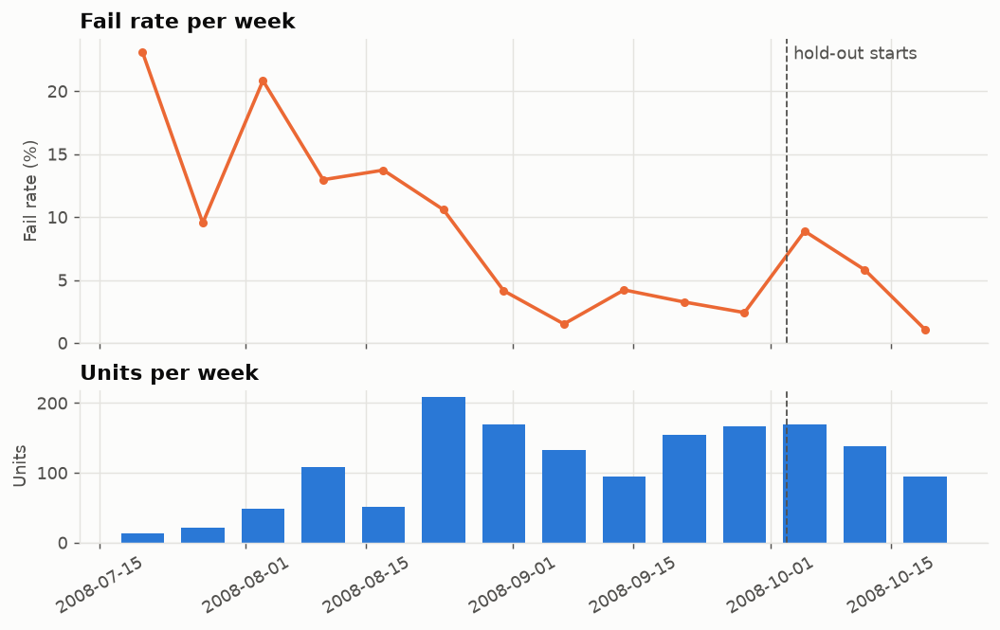
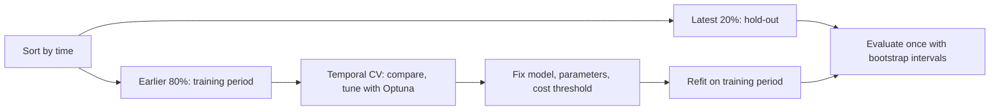
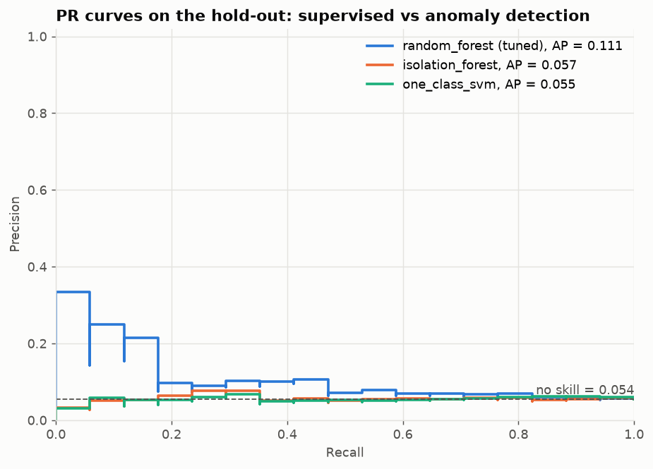
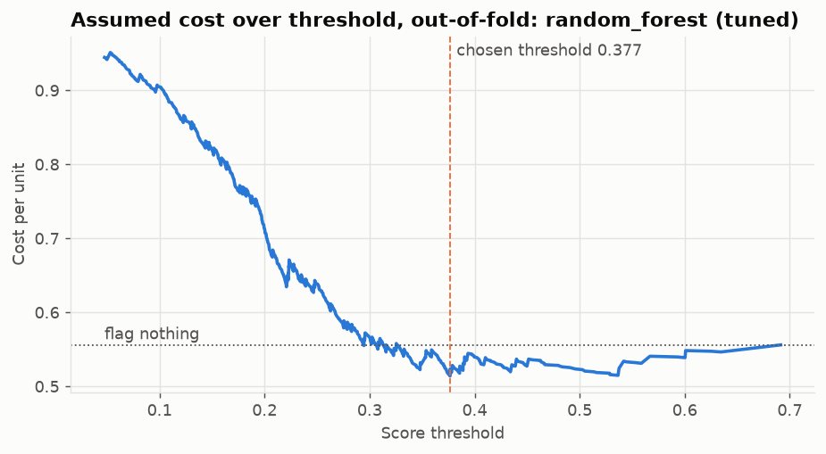
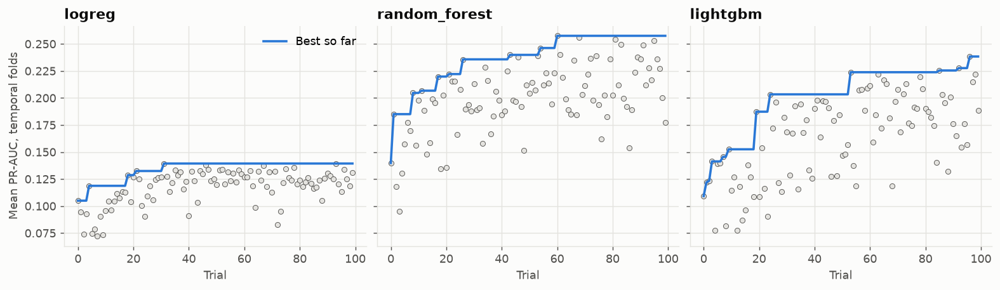
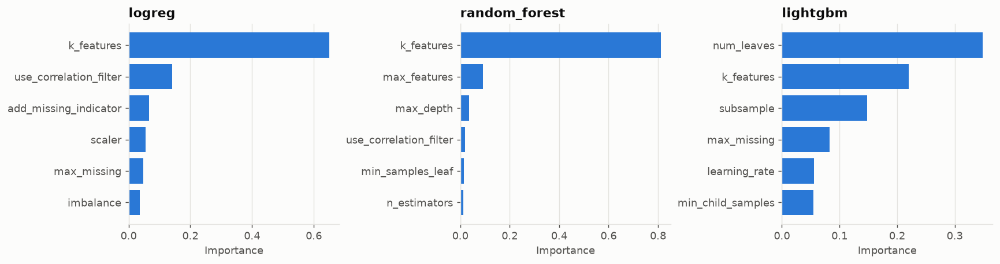
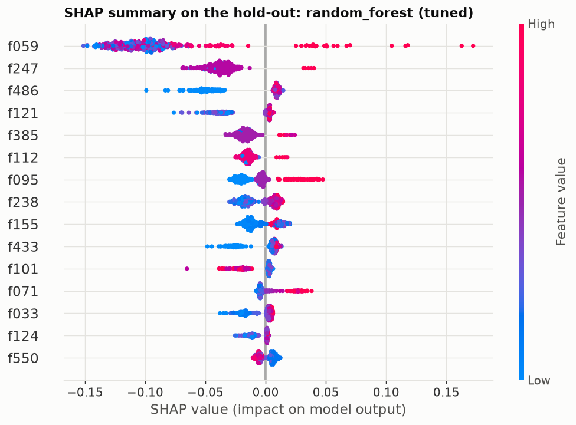
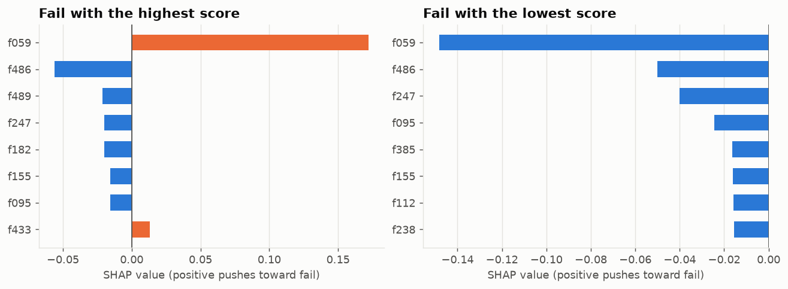

# Quality Prediction and Anomaly Detection on SECOM

[](https://github.com/maxritter0714-sketch/secom-quality-prediction/actions/workflows/ci.yml)

Can process and sensor data from a production line predict whether a unit will fail, and can
outliers be found without labels? This project answers both for the SECOM semiconductor dataset
with a complete, leakage-free scikit-learn pipeline and a deliberately strict evaluation: models,
parameters and thresholds are fixed on an earlier period and tested once on a later one.

**The honest result:** the later period offers only weak evidence of predictive signal. The model
selected by cross-validation ranks fails above the base rate as a point estimate, but its confidence
interval includes the no-skill level, and it catches only a small share of fails. A model that was not
selected has an interval above that level, which is weak evidence when several scores are compared.
The anomaly detectors perform at the no-skill level. Cross-validation scores on the training period,
above all with shuffled folds, paint a rosier picture. Showing that gap, and not hiding it, is the
point of this project.

## Dataset

| | |
|---|---|
| Source | [UCI Machine Learning Repository, dataset 179](https://archive.ics.uci.edu/dataset/179/secom) |
| Citation | McCann, M. & Johnston, A. (2008). SECOM [Dataset]. UCI Machine Learning Repository. <https://doi.org/10.24432/C54305> |
| License | [CC BY 4.0](https://creativecommons.org/licenses/by/4.0/) |
| Content | 1,567 units with 590 anonymous numeric features, a pass/fail label and a timestamp; 104 fails |

UCI states 591 attributes; `secom.data` contains 590 feature columns. The labels and timestamps are
in a separate file. The data is downloaded by a script and is not part of this repository.

The fail rate drifts strongly over the recorded period, which is why validation follows time:



The [EDA notebook](notebooks/01_eda.ipynb) covers missing values, constant features and correlation.

## Approach



Every step below is fitted inside the training fold, as one pipeline:

1. Drop features with too many missing values
2. Impute with the median, optionally adding missing-value indicators
3. Drop constant features
4. Optionally drop highly correlated features
5. Scale, where the model or SMOTE needs it
6. Select the top k features by ANOVA F-score
7. Optionally oversample with SMOTE, during fit only
8. Fit the classifier: dummy, logistic regression, random forest or LightGBM

Tests check that imputer statistics come only from training rows, that later rows cannot change a
fitted transform, and that feature selection inside cross-validation finds no skill on pure noise.
Reasons for the less obvious choices are in [docs/decisions.md](docs/decisions.md).

**Why not accuracy?** With about 7 % fails, flagging nothing reaches about 93 % accuracy and detects
nothing. PR-AUC is the main metric, because it focuses on the rare class. Its no-skill level equals
the fail rate of the evaluated period, so scores are only comparable with that in mind.

**Threshold.** A missed fail is assumed to cost 10 and a false alarm 1. This cost matrix is an
assumption, not a measurement. The threshold minimizes this cost on out-of-fold training scores and
is applied unchanged to the hold-out.

## Results

All tables below are generated by `run_experiments.py` and inserted by `scripts/update_readme.py`.

### Hold-out period

<!-- BEGIN: Hold-out summary -->
| Model | PR-AUC (CV) | PR-AUC (hold-out, 95% CI) | ROC-AUC | Recall at precision >= 0.5 | Balanced accuracy | Cost per unit (95% CI) | TP / FP / FN / TN |
|---|---|---|---|---|---|---|---|
| dummy | 0.056 | 0.054 [0.029, 0.080] | 0.500 | 0.000 | 0.500 | 0.543 [0.288, 0.799] | 0 / 0 / 17 / 296 |
| logreg (default) | 0.110 | 0.143 [0.045, 0.319] | 0.590 | 0.059 | 0.528 | 0.514 [0.288, 0.770] | 1 / 1 / 16 / 295 |
| logreg (tuned) | 0.139 | 0.260 [0.090, 0.486] | 0.697 | 0.118 | 0.559 | 0.479 [0.256, 0.735] | 2 / 0 / 15 / 296 |
| random_forest (default) | 0.164 | 0.081 [0.044, 0.147] | 0.636 | 0.000 | 0.486 | 0.569 [0.313, 0.837] | 0 / 8 / 17 / 288 |
| random_forest (tuned) | 0.257 | 0.111 [0.046, 0.279] | 0.607 | 0.000 | 0.524 | 0.521 [0.288, 0.783] | 1 / 3 / 16 / 293 |
| lightgbm (default) | 0.182 | 0.080 [0.043, 0.158] | 0.619 | 0.000 | 0.492 | 0.559 [0.307, 0.827] | 0 / 5 / 17 / 291 |
| lightgbm (tuned) | 0.238 | 0.095 [0.051, 0.206] | 0.672 | 0.000 | 0.568 | 0.534 [0.332, 0.754] | 5 / 47 / 12 / 249 |
| isolation_forest | 0.119 | 0.057 [0.032, 0.102] | 0.490 | 0.000 | 0.500 | 0.543 [0.288, 0.799] | 0 / 0 / 17 / 296 |
| one_class_svm | 0.083 | 0.055 [0.032, 0.103] | 0.494 | 0.000 | 0.505 | 0.581 [0.351, 0.831] | 2 / 32 / 15 / 264 |
<!-- END: Hold-out summary -->

Selected by cross-validation, before the hold-out was evaluated:
<!-- BEGIN: Selected model -->
`random_forest (tuned)`
<!-- END: Selected model -->

Cost of the two trivial policies, as a yardstick for the cost column:

<!-- BEGIN: Reference costs -->
| policy | cost_per_unit |
|---|---|
| flag no unit | 0.543 |
| flag every unit | 0.946 |
<!-- END: Reference costs -->

How to read this:

- **Cross-validation overstates the selected model.** Its hold-out PR-AUC is well below its CV score,
  and the selection among 100 trials per model on few fails makes this expected.
- **The best hold-out score belongs to a model that was not selected.** Tuned logistic regression
  scores highest on the hold-out, and its interval is the only one above the dummy's score. It still
  overlaps with the selected model's interval, and it is the best of several compared scores.
  Switching to it now would use the hold-out for selection and invalidate the estimate, so it stays a
  hypothesis for a new evaluation period.
- **The cost assumption does not yield a demonstrated saving.** Every interval contains the cost of
  flagging no unit at all.
- **Balanced error rate** equals 1 minus balanced accuracy. The UCI baselines report 33.5 % to 40.1 %
  for 10-fold cross-validation with 40 selected features, per the `secom.names` file of the dataset.
  They are an external reference and not directly comparable with a chronological hold-out.





### Why temporal validation matters

Comparison on the training period only, with default parameters:

<!-- BEGIN: Candidate comparison -->
| model | imbalance | pr_auc_temporal_mean | pr_auc_temporal_std | pr_auc_shuffled_mean | pr_auc_shuffled_std |
|---|---|---|---|---|---|
| dummy | none | 0.056 | 0.035 | 0.069 | 0.002 |
| logreg | none | 0.127 | 0.073 | 0.150 | 0.032 |
| logreg | weighted | 0.110 | 0.059 | 0.152 | 0.039 |
| logreg | smote | 0.120 | 0.065 | 0.156 | 0.042 |
| random_forest | none | 0.128 | 0.077 | 0.189 | 0.040 |
| random_forest | weighted | 0.164 | 0.151 | 0.229 | 0.075 |
| random_forest | smote | 0.174 | 0.175 | 0.196 | 0.076 |
| lightgbm | none | 0.156 | 0.024 | 0.211 | 0.059 |
| lightgbm | weighted | 0.182 | 0.071 | 0.208 | 0.064 |
| lightgbm | smote | 0.174 | 0.125 | 0.200 | 0.078 |
<!-- END: Candidate comparison -->

Shuffled folds score higher than temporal folds for every candidate. Part of this comes from the fold
composition rather than from model quality: the dummy classifier's PR-AUC simply follows the fail
rate of the validated rows, and it differs as well. Temporal folds also omit the fail-rich start
of the recording from validation. The clearer warning is the step from the temporal CV score to the
hold-out, on data the models have never seen.

Across imbalance strategies, the differences are within the fold-to-fold spread, so this data supports
no clear winner between no handling, class weights and SMOTE.

### Hyperparameter optimization

One Optuna study per model with a seeded TPE sampler, maximizing mean PR-AUC over temporal folds. The
search space includes preprocessing: missing-value threshold, k, correlation filter, indicators
and imbalance strategy.

<!-- BEGIN: Default vs tuned -->
| model | cv_pr_auc_mean | cv_pr_auc_std | threshold | balanced_accuracy | balanced_error_rate | cost_per_unit | tn | fp | fn | tp |
|---|---|---|---|---|---|---|---|---|---|---|
| dummy | 0.056 | 0.035 | 0.139 | 0.631 | 0.369 | 0.481 | 804 | 183 | 32 | 26 |
| logreg (default) | 0.110 | 0.059 | 0.972 | 0.536 | 0.464 | 0.528 | 955 | 32 | 52 | 6 |
| logreg (tuned) | 0.139 | 0.056 | 0.647 | 0.532 | 0.468 | 0.528 | 965 | 22 | 53 | 5 |
| random_forest (default) | 0.164 | 0.151 | 0.271 | 0.625 | 0.375 | 0.493 | 792 | 195 | 32 | 26 |
| random_forest (tuned) | 0.257 | 0.180 | 0.377 | 0.575 | 0.425 | 0.514 | 880 | 107 | 43 | 15 |
| lightgbm (default) | 0.182 | 0.071 | 0.247 | 0.563 | 0.437 | 0.497 | 958 | 29 | 49 | 9 |
| lightgbm (tuned) | 0.238 | 0.165 | 0.433 | 0.623 | 0.377 | 0.477 | 839 | 148 | 35 | 23 |
<!-- END: Default vs tuned -->

This table shows out-of-fold results. The tuned CV scores are optimistic, because trials were selected
on these same folds. On the hold-out, each tuned model has a higher PR-AUC than its default, but the
intervals overlap widely, so this does not prove a benefit from tuning. The dummy's good cost value
here is a drift artefact, explained in [docs/decisions.md](docs/decisions.md).





### Supervised vs unsupervised

`IsolationForest` and `OneClassSVM` are fitted on training units labelled good, so strictly this is
semi-supervised: labels filter the fit data and evaluate the scores, but are never a learning target.
Fitting on all units would be fully label-free, but would treat known fails as normal.

Both detectors show a ROC-AUC of about 0.5 on the hold-out and a PR-AUC at the no-skill level (see the
table above), so they add no usable signal here. A plausible explanation is that fails in this data do
not look like global outliers across hundreds of features; this data cannot confirm that.

### Interpretability

Explanations are for the best tree model by CV score and use the hold-out period.



Two individual fails, the best and the worst ranked by the model:



Permutation importance on the hold-out:

<!-- BEGIN: Permutation importance -->
| feature | importance_mean | importance_std |
|---|---|---|
| f059 | 0.013 | 0.026 |
| f247 | 0.005 | 0.001 |
| f095 | 0.005 | 0.007 |
| f433 | 0.004 | 0.006 |
| f510 | 0.004 | 0.002 |
| f112 | 0.004 | 0.001 |
| f550 | 0.004 | 0.005 |
| f423 | 0.003 | 0.001 |
| f162 | 0.003 | 0.003 |
| f217 | 0.003 | 0.002 |
| f033 | 0.003 | 0.014 |
| f205 | 0.003 | 0.003 |
| f419 | 0.003 | 0.001 |
| f090 | 0.002 | 0.003 |
| f124 | 0.002 | 0.001 |
<!-- END: Permutation importance -->

The feature `f059` leads all rankings, but in the permutation table its effect is smaller than its
spread. So this is a lead worth checking, not a finding. Because features are anonymous, no physical
interpretation is possible. On a real line, such as laser welding, these rankings would be reviewed
with process experts.

## Limitations

- **Few fails.** The hold-out contains only a small number of fails, so all its numbers are uncertain,
  as the wide intervals show.
- **Small dataset with drift.** The fail rate changes strongly, and the reason is unknown. Models
  trained on the fail-rich start may not transfer to later periods.
- **Anonymous features.** Domain knowledge cannot be used, and rankings cannot be validated.
- **Cost matrix is an assumption.** Different costs would lead to different thresholds.
- **Semiconductor data.** This is a different process from, say, laser welding. The method carries
  over, the results do not.
- **One split in time.** Results depend on where the hold-out begins.
- **Hold-out reruns.** The full pipeline ran more than once while fixing report formatting. No model,
  parameter or threshold changed between these runs, and the numbers were identical.

## Reproduce

```bash
python -m venv .venv
source .venv/bin/activate      # Windows: .venv\Scripts\activate
pip install -r requirements.txt
pip install -e . --no-deps
python scripts/download_data.py
python run_experiments.py      # add --fast for a smoke test writing to artifacts/
python scripts/update_readme.py
jupyter nbconvert --to notebook --execute --inplace notebooks/01_eda.ipynb  # EDA figures
pytest
```

<!-- BEGIN: Run information -->
| item | value |
|---|---|
| Python | 3.12.10 |
| Units / features | 1567 / 590 |
| Training units | 1254 |
| Hold-out units / fails | 313 / 17 |
| Optuna trials per model | 100 |
| Assumed cost (missed fail / false alarm) | 10 / 1 |
| Runtime (minutes) | 20.1 |
<!-- END: Run information -->

Seeds are fixed in `src/secom/config.py`. Numeric results may differ slightly across operating systems
or library versions. The full numbers are in [reports/results.md](reports/results.md).

## Next steps

- Evaluate several rolling hold-out periods to reduce the dependence on one split
- Compensate for drift, for example with recency weighting or sliding training windows
- Calibrate probabilities, so that one threshold transfers better over time
- Apply the pipeline to a larger dataset with more fails, such as the Bosch Production Line data
- Serve the model behind a small FastAPI endpoint

## License

Code: [MIT](LICENSE). Data: CC BY 4.0, by the dataset authors cited above.
